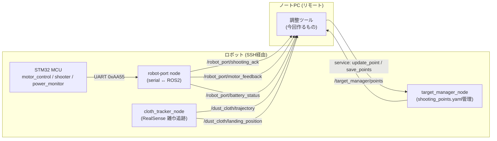
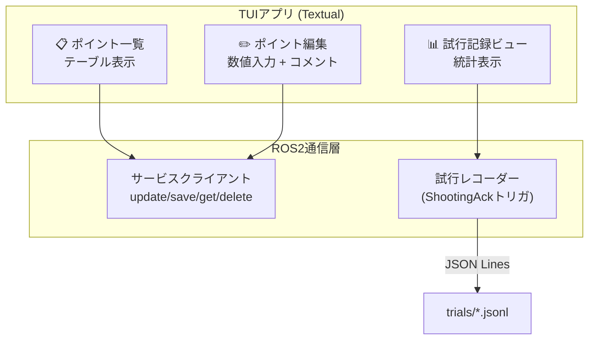
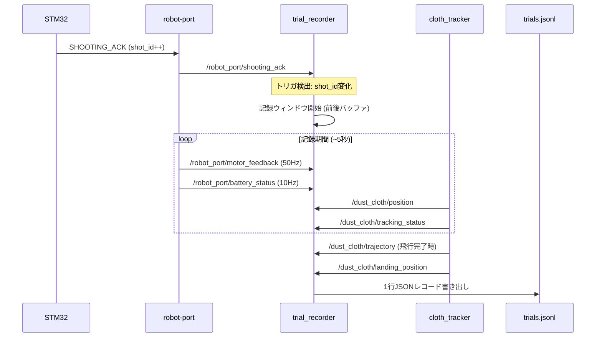

# 調査結果と方針提案: Shooting Point Editor & Trial Recorder

## 1. 現状の全体像



## 2. 既存インターフェースまとめ

### shooting_points.yaml のスキーマ
| フィールド | 型 | 説明 |
|---|---|---|
| `id` | string | 一意ID (e.g. `target_1`) |
| `name` | string | 表示名 |
| `x`, `y`, `z` | float | マップ座標 (m) |
| `yaw` | float | ロボット向き (rad) |
| `pitch` | float | 射出仰角 (rad) |
| `shooter_power` | float | 出力 (0.0–1.0) |
| `enabled` | bool | 有効/無効 |
| `comment` | string | メモ |
| `group` | string | グループ分け |
| `priority` | int | グループ内優先度 |

### target_manager_node のサービス
- `/target_manager/update_point` — ポイントの作成・更新
- `/target_manager/get_point` — 全ポイント or 個別取得
- `/target_manager/delete_point` — 削除
- `/target_manager/save_points` — YAMLへ書き出し

### robot-port のトピック (射出時データ)
- `/robot_port/shooting_ack` — **shot_id(カウンタ)**, 成否, 射出時RPM・電圧・電流
- `/robot_port/motor_feedback` — モーターRPM・電流 (50Hz)
- `/robot_port/battery_status` — バッテリー電圧・電流 (10Hz)

### realsense_dust_cloth のトピック
- `/dust_cloth/trajectory` — 3D軌跡（多項式フィット）
- `/dust_cloth/landing_position` — 着弾位置 (map frame)
- `/dust_cloth/tracking_status` — 追跡状態 (IDLE/TRACKING/LANDED/LOST)

## 3. VSCode拡張 vs ターミナルGUI: 判断

| 観点 | VSCode拡張 (WebView) | ターミナルTUI (Python/textual等) |
|---|---|---|
| **開発コスト** | 高い (TypeScript + WebView + ROS bridge) | 中程度 (Python + rclpy直接) |
| **ROS2連携** | 間接的 (WebSocket/HTTP bridge必要) | 直接 (rclpyでサービス呼び出し) |
| **地図描画** | Canvas/SVGで自由度高い | 限定的（ASCII or sixel） |
| **数値微調整** | テキスト入力 + スピナー | テキスト入力 + インクリメント |
| **誤操作防止** | ボタン・フォーム明確 | キー操作明確、マウス不要 |
| **SSH越し** | VSCode Remote SSHで動作 | SSH端末で直接動作 |
| **メンテナンス** | TypeScript + npm依存 | Python単体、依存少 |
| **マップ表示** | ◎ 2Dキャンバス描画可能 | △ 簡易表示のみ |

> [!IMPORTANT]
> **推奨: ハイブリッド案 — Python TUIベース + 必要時のみWebビュー**
>
> 理由:
> 1. ROS2との通信がrclpyで**直接**できる（ブリッジ不要 = シンプル）
> 2. SSH越しでターミナルのみで完結する（VSCode不要でも使える）
> 3. 誤操作防止はキーボード操作 + 確認プロンプトの方がマウスドラッグより安全
> 4. マップ上の2D可視化が必要な場面は**RViz**で十分対応可能
> 5. メンテナンスが圧倒的に楽（Python + YAML、npm/webpackなし）

## 4. 提案アーキテクチャ

### ツール構成: `gn10_shot_manager` パッケージ (Python)

```
src/gn10-shot-manager/
├── package.xml
├── setup.py
├── config/
│   └── default.yaml           # ツール設定
├── gn10_shot_manager/
│   ├── __init__.py
│   ├── tui_app.py             # メインTUIアプリ (Textual)
│   ├── point_editor.py        # ポイント編集パネル
│   ├── trial_recorder.py      # 射出試行記録ノード
│   ├── trial_viewer.py        # 記録閲覧・統計パネル
│   └── ros_bridge.py          # ROS2サービス/トピック通信ラッパー
├── data/
│   └── trials/                # 試行ログ (JSON Lines)
└── launch/
    └── shot_manager.launch.py
```

### 機能分割



### 4A. ポイントエディタ機能

| 操作 | 詳細 |
|---|---|
| **一覧表示** | 全ターゲットをテーブル表示 (id, name, x, y, yaw, pitch, power, enabled, group) |
| **選択・編集** | 方向キーで選択、Enterで編集モード。各フィールドを数値入力 |
| **微調整** | x/y: ±0.001m刻み、yaw/pitch: ±0.01rad刻み、power: ±0.01刻み (矢印キー) |
| **コメント** | 自由テキスト入力 |
| **有効/無効** | スペースキーでトグル |
| **保存** | `Ctrl+S` → update_point → save_points → Git自動コミット |
| **差分表示** | 保存前に変更差分をハイライト表示 |

### 4B. 試行記録機能



### 試行レコードのスキーマ (JSON Lines)

```json
{
  "shot_id": 42,
  "timestamp": "2026-10-26T14:30:00.123+09:00",
  "target_id": "target_1",
  "target": { "x": 3.25, "y": 1.8, "yaw": 1.5708, "pitch": 0.35, "power": 0.8 },
  "shot_instant": {
    "motor_rpm": 4200.0,
    "voltage": 23.8,
    "current": 12.5
  },
  "motor_feedback_window": [
    { "t": -0.5, "rpm": 4180, "current": 11.2 },
    { "t": 0.0, "rpm": 4200, "current": 12.5 },
    { "t": 0.5, "rpm": 3800, "current": 5.0 }
  ],
  "battery_window": [
    { "t": -0.5, "voltage": 24.0, "current": 11.0 },
    { "t": 0.0, "voltage": 23.8, "current": 12.5 }
  ],
  "trajectory": {
    "launch_position": { "x": 1.0, "y": 0.5, "z": 0.8 },
    "landing_position": { "x": 3.1, "y": 1.75, "z": 0.0 },
    "max_height": 2.1,
    "flight_time": 1.2,
    "total_distance": 2.8
  },
  "landing_error": { "dx": -0.15, "dy": -0.05, "distance": 0.158 },
  "comment": ""
}
```

### 4C. 統計ビュー

TUIの3つ目のタブで、ターゲットごとの統計を表示:
- 試行回数
- 着弾誤差の平均・標準偏差
- 電圧・RPMの推移トレンド
- 直近N回の結果一覧

## 5. ファームウェア変更 (最小限)

> [!NOTE]
> **現状のファームウェアで必要なデータはほぼすべて送信済み。**
> 追加が必要なのは `robot-port` 側の対応のみ。

- `robot-port` に `shot_count` トピック追加は不要 — `ShootingAck.shot_id` が既にカウンタとして機能
- `trial_recorder` が `/robot_port/shooting_ack` を直接サブスクライブしてトリガとする

## 6. 実装ロードマップ

### Phase 1: ポイントエディタTUI (最優先)
1. `gn10_shot_manager` パッケージ作成
2. `ros_bridge.py` — rclpyでサービス通信ラッパー
3. `point_editor.py` — Textual TUIでポイント編集
4. Git自動コミット機能
5. **目標: 座標の確認・微調整・保存・コメント記録が確実にできる**

### Phase 2: 試行レコーダー
1. `trial_recorder.py` — ShootingAckトリガ + 時系列記録
2. バッファリング + JSON Lines書き出し
3. 記録の基本的なターミナル表示

### Phase 3: 統計・分析ビュー
1. `trial_viewer.py` — 記録データの統計表示
2. ターゲットごとの着弾精度分析
3. 電圧・RPMトレンド表示

## 7. 技術選定

| 要素 | 選択 | 理由 |
|---|---|---|
| 言語 | **Python** | rclpy直結、Textual TUI、開発速度 |
| TUIフレームワーク | **[Textual](https://textual.textualize.io/)** | リッチなターミナルUI、テーブル・フォーム・タブ対応 |
| ROS2通信 | **rclpy** | ブリッジ不要で直接サービス呼び出し |
| 記録形式 | **JSON Lines** | 追記容易、行単位で読める、jqで処理可能 |
| バージョン管理 | **gitpython** | Pythonからgit commit自動化 |

## 8. 見送り項目（複雑さ回避）

| 機能 | 理由 |
|---|---|
| ❌ VSCode WebView拡張 | ROS2ブリッジが必要で複雑、TypeScript + npm依存が増える |
| ❌ 2Dマップ上のドラッグ＆ドロップ | マウス操作は精度が低い + TUIでは実用的でない → RVizで補完 |
| ❌ ゴースト表示（過去軌跡オーバーレイ） | RVizのMarkerで対応可能、独自実装は過剰 |
| ❌ 着弾率グラフのリッチ描画 | TUIのスパークライン + 数値表で十分。詳細分析はJupyter等で |

> [!TIP]
> **「シンプルで信頼性のある記録ツール兼調整エディタ」** という要件に対して、
> Textual TUI + rclpy + JSON Lines の組み合わせが最もメンテナンスコストが低く、
> SSH越しでも確実に動作する構成です。
> 
> 2D可視化が必要な場合はRViz（既存インフラ）に任せ、このツールは
> **「数値精密編集 + 確実な保存 + 試行記録」** に特化させます。
